<div align="center">

# 🌾 Asan Kasht Kari

### Easy AI tools for farmers — detect crop diseases early and track every rupee of farming cost.


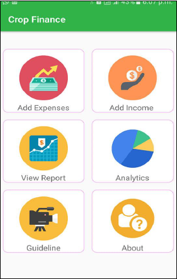

</div>

> 🔒 **Source code is private.** This repository contains documentation, screenshots and project information only. For demos, partnerships or access requests, see [Contact](#-contact).

---

## 📑 Table of contents

1. [About](#-about)
2. [The problem](#-the-problem)
3. [Our solution](#-our-solution)
4. [Module 1: Crop Disease Detection](#-module-1-crop-disease-detection)
5. [Module 2: Crop Finance](#-module-2-crop-finance)
6. [App walkthrough (screenshots)](#-app-walkthrough)
7. [How costs and profit are calculated](#-how-costs-and-profit-are-calculated)
8. [Why Asan Kasht Kari](#-why-asan-kasht-kari)
9. [Research foundation](#-research-foundation)
10. [Rollout and partnerships](#-rollout-and-partnerships)
11. [Tech overview](#-tech-overview)
12. [Team](#-team)
13. [Contact](#-contact)

---

## 📖 About

**Asan Kasht Kari** ("easy farming") is an agricultural-technology startup building simple, affordable AI tools for **underserved farmers**. We combine machine learning, computer vision and mobile technology to help growers with two everyday questions:

- 🔬 **What is wrong with my crop?**
- 💰 **Am I actually making a profit?**

The startup grew out of years of research in machine learning, image processing and computer vision applied to agriculture, and has been commercialized as a product for farmers.

---

## ⚠️ The problem

- Crop diseases, mostly **fungal**, spread quickly and cause heavy losses when they are not identified early.
- Many small farmers cannot easily reach an expert or a research institute to diagnose a problem in time.
- Most farmers do not keep records of what each crop costs, so they cannot tell which crops and seasons really make money.
- Existing tools often ignore the way farmers work: local land units (kanal, marla, murraba) and local weights (maund).

## ✅ Our solution

Two connected mobile tools, designed to be easy enough for first-time smartphone users:

| | Disease Detection | Crop Finance |
|---|---|---|
| **Question answered** | What disease does my crop have? | What did this crop cost and earn? |
| **Crops** | Rice, wheat, sugarcane, cotton, maize | Rice, wheat, sugarcane, cotton, maize |
| **Outcome** | Early action, reduced crop loss | Clear profit and loss per crop, year and season |

---

## 🔬 Module 1: Crop Disease Detection

An app that helps farmers identify diseases in their crops early, so they can act before losses grow.

| Detail | Coverage |
|---|---|
| **Crops** | Rice · Wheat · Sugarcane · Cotton · Maize |
| **Disease focus** | Mainly **fungal** diseases, organised into several categories |
| **Approach** | Machine learning, image processing and computer vision |
| **Built with** | Research collaboration with the Ayub Agricultural Research Institute (AARI), Faisalabad |

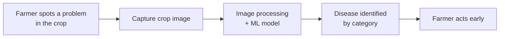

---

## 💰 Module 2: Crop Finance

An Android app where a farmer records the cost of each stage of farming and sees profit at a glance.

| Feature | What it does |
|---|---|
| 🔐 **Secure registration and login** | Farmers register with full name, username, address, phone number, password and email, so their data stays protected |
| 🧾 **Add Expenses** | Select crop → season → task → land area and unit → cost per unit → date and time |
| 💵 **Add Income** | Record income earned from a crop and season |
| 📊 **View Report** | Choose crop, year and season to see itemised expenses, total expenses, income and net profit |
| 📈 **Analytics** | Donut chart comparing income, expenses and net profit |
| 🎥 **Guideline** | Video guidance on how to use the app |
| ℹ️ **About** | Information about the app |

**Crops:** Rice · Wheat · Sugarcane · Cotton · Maize

**Tasks tracked:** Tillage · Seed · Irrigation · Fertilizers · Sprays · Harvesting · Labor

**Local land units:** Acre · Hectare · Murraba · Kanal · Marla

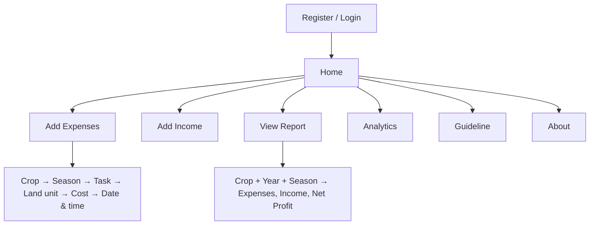

---

## 📱 App walkthrough

### 1. Sign in or create an account

<p align="center">
  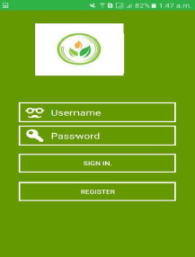
  &nbsp;&nbsp;
  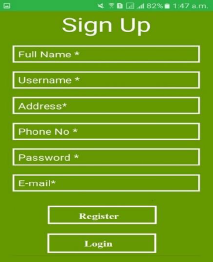
  &nbsp;&nbsp;
  
</p>
<p align="center"><em>Login · Sign up · Home with six options</em></p>

### 2. Record expenses

<p align="center">
  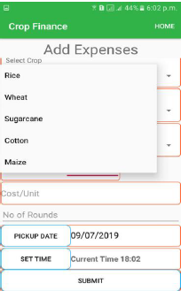
  &nbsp;&nbsp;
  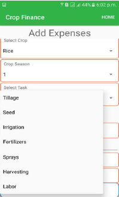
  &nbsp;&nbsp;
  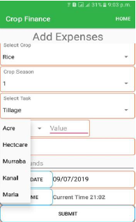
</p>
<p align="center"><em>Choose the crop · Choose the task · Choose the land unit</em></p>

### 3. See the results

<p align="center">
  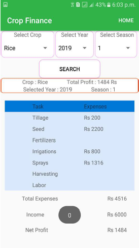
  &nbsp;&nbsp;
  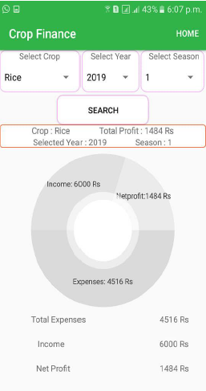
</p>
<p align="center"><em>Itemised report with net profit · Analytics chart</em></p>

---

## 🧮 How costs and profit are calculated

Each task is calculated from the quantity the farmer enters and the price per unit. The example below is for one acre.

<p align="center">
  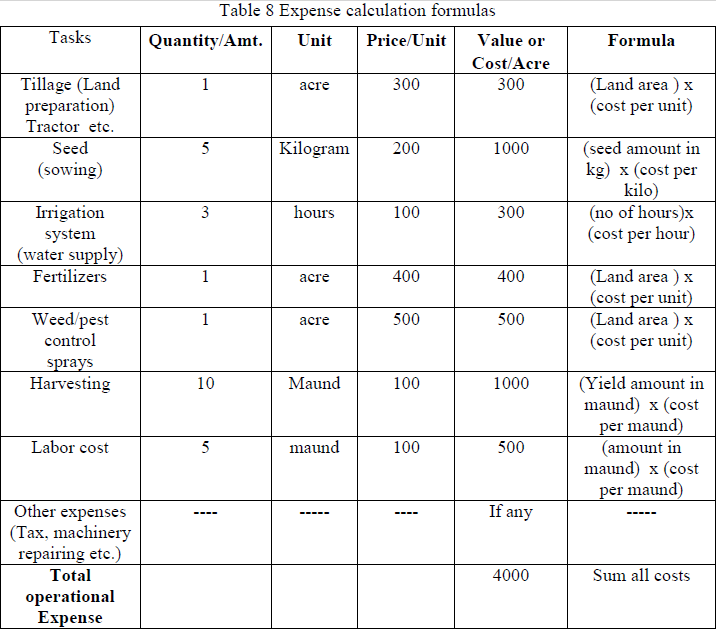
</p>

| Task | Quantity | Unit | Price/Unit | Cost/Acre | Formula |
|---|---|---|---|---|---|
| Tillage (land preparation) | 1 | acre | 300 | 300 | land area × cost per unit |
| Seed (sowing) | 5 | kg | 200 | 1000 | seed amount (kg) × cost per kg |
| Irrigation (water supply) | 3 | hours | 100 | 300 | hours × cost per hour |
| Fertilizers | 1 | acre | 400 | 400 | land area × cost per unit |
| Weed/pest control sprays | 1 | acre | 500 | 500 | land area × cost per unit |
| Harvesting | 10 | maund | 100 | 1000 | yield (maund) × cost per maund |
| Labor | 5 | maund | 100 | 500 | amount (maund) × cost per maund |
| Other expenses (tax, machinery repair, etc.) | – | – | – | if any | – |
| **Total operational expense** | | | | **4000** | sum of all costs |

```text
Net Profit = Income − Total Expenses
```

**Worked example from the report screen** (Rice, 2019, Season 1):

| Item | Amount |
|---|---|
| Total expenses | Rs 4,516 |
| Income | Rs 6,000 |
| **Net profit** | **Rs 1,484** |

---

## 🎯 Why Asan Kasht Kari

- **Built for underserved farmers.** Simple screens, dropdown choices instead of typing, and video guidance.
- **Speaks the farmer's language of measurement.** Acre, hectare, murraba, kanal, marla and maund are built in.
- **Two tools in one.** Protects the crop (disease detection) and the income (finance tracking).
- **Grounded in research.** Based on years of machine learning and computer vision work in agriculture, developed with an agricultural research institute.
- **Private by design.** Each farmer has their own account and data.

---

## 🔬 Research foundation

Asan Kasht Kari builds on academic research in applied machine learning for agriculture:

- Research in **machine learning, image processing and computer vision** applied to crops
- **AXPERT**, a crop disease platform developed with the **Ayub Agricultural Research Institute (AARI), Faisalabad**
- Published work in *Current Science* (2019) on an improved single-linkage clustering method

---

## 🗺️ Rollout and partnerships

| Phase | Focus | Channels / partners |
|---|---|---|
| **Phase A** | Awareness and digital marketing | Podcasts, radio, social media platforms |
| **Phase B** | Research and institutional partnerships | Ayub Agricultural Research Institute, universities, and organisations promoting smart and sustainable farming |

---

## 🛠️ Tech overview

| Area | Technology |
|---|---|
| Mobile app | Android |
| Disease detection | Machine learning, image processing, computer vision |
| Accounts | Per-farmer registration and login |
| Reporting | Itemised reports and donut-chart analytics |

*Detailed architecture and source code are private.*

---

## 👩‍💻 Team

**Arshia Naeem** — Founder and research lead
Senior Lecturer and entrepreneurship instructor, Computer Science. MS in Computer Science (Lahore College for Women University). Research focus: machine learning, image processing and computer vision for agriculture.

**Research partner:** Ayub Agricultural Research Institute (AARI), Faisalabad

<!-- Add student developers / collaborators here, e.g. "Crop Finance app developed by Name under the supervision of Arshia Naeem". -->

---

## 📬 Contact

- GitHub: [@arshiyanaeem](https://github.com/arshiyanaeem)
- Email: <!-- add your email -->
- For demos, partnerships, pilots or code-access requests, please open an issue or reach out directly.

---

## 📄 License

© Asan Kasht Kari. All rights reserved. The source code is proprietary and private. Documentation and screenshots may not be reused without permission.
